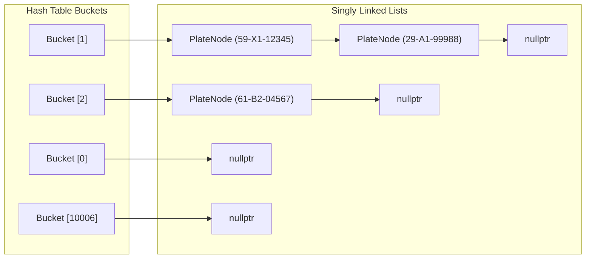

# 02. Kiến Trúc Hệ Thống & Cấu Trúc Dữ Liệu (Architecture & Data Structures)

Tài liệu này đặc tả chi tiết kiến trúc kỹ thuật nội bộ của hệ thống quản lý biển số xe, phục vụ cả việc sinh code chuẩn xác cho AI và làm cơ sở lý thuyết cho sinh viên khi vấn đáp bảo vệ đồ án.

---

## 1. Thiết Kế Cấu Trúc Dữ Liệu C++

### 1.1. Cấu trúc một Node dữ liệu (`PlateNode`)

Mỗi biển số xe được biểu diễn bằng một Node đơn vị trong danh sách liên kết giải quyết xung đột:

```cpp
#pragma once
#include <cstring>

struct PlateNode {
    char fullPlate[16];      // Chuỗi biển số chuẩn: "59-X1-12345\0" (max 15 ký tự)
    char provinceCode[4];    // Mã tỉnh: "59\0"
    char wardCode[4];        // Mã xã: "X1\0"
    char serialNum[8];       // Số thứ tự xe: "12345\0"
    char registeredDate[12]; // Ngày đăng ký: "2026-10-30\0"
    char ownerName[50];      // Tên chủ sở hữu phương tiện
    PlateNode* next;         // Con trỏ trỏ tới Node kế tiếp trong cùng một Bucket

    // Constructor khởi tạo mặc định
    PlateNode() : next(nullptr) {
        fullPlate[0] = '\0';
        provinceCode[0] = '\0';
        wardCode[0] = '\0';
        serialNum[0] = '\0';
        registeredDate[0] = '\0';
        ownerName[0] = '\0';
    }
};
```

> **Tại sao dùng mảng `char[]` thay vì `std::string` trong Node?**  
> Việc sử dụng mảng ký tự cố định kích thước nhỏ gọn giúp Node có kích thước byte dự đoán được trong bộ nhớ, hạn chế phân mảnh Heap (heap fragmentation) và dễ dàng dump trực tiếp ra file nhị phân/văn bản.

---

### 1.2. Cấu trúc Bảng Băm (`LicensePlateHashTable`)

Bảng băm sử dụng kỹ thuật **Separate Chaining (Nối kết trực tiếp bằng danh sách liên kết)**:

```cpp
class LicensePlateHashTable {
private:
    static const int TABLE_SIZE = 10007; // Số nguyên tố lớn để phân bố đều và giảm xung đột
    PlateNode* buckets[TABLE_SIZE];      // Mảng các con trỏ quản lý đầu danh sách liên kết
    int totalCount;                      // Tổng số biển số xe hiện có trong hệ thống

public:
    LicensePlateHashTable();
    ~LicensePlateHashTable();

    // Hàm băm chuỗi
    int hashFunction(const char* plate) const;

    // Các thao tác cốt lõi
    bool insertPlate(const PlateNode& newPlate);
    PlateNode* searchPlate(const char* plate) const;
    bool removePlate(const char* plate);

    // Truy vấn thống kê
    void displayWardsOfProvince(const char* provCode) const;
    void displayPlatesOfWard(const char* provCode, const char* wardCode) const;
    int countPlatesByProvince(const char* provCode) const;

    // Tiện ích & Quản lý bộ nhớ
    int getTotalCount() const;
    void clear();
    double getLoadFactor() const; // Hệ số tải = totalCount / TABLE_SIZE
};
```

---

## 2. Giải Thuật Băm (Hash Function)

Để hạn chế tối đa va chạm băm (hash collisions) giữa các biển số có cấu trúc tương tự nhau (ví dụ: `59-X1-12345` và `59-X1-12346`), hệ thống áp dụng thuật toán **DJB2** (Daniel J. Bernstein) hoặc **Polynomial Rolling Hash**.

### 2.1. Cài đặt thuật toán DJB2:

Thuật toán DJB2 sử dụng số khởi tạo `5381` và phép nhân với `33`:

$$\text{hash}_{i} = (\text{hash}_{i-1} \times 33) + c = ((\text{hash}_{i-1} \ll 5) + \text{hash}_{i-1}) + c$$

```cpp
int LicensePlateHashTable::hashFunction(const char* plate) const {
    if (!plate || plate[0] == '\0') return 0;
    
    unsigned long hash = 5381;
    int c;
    while ((c = static_cast<unsigned char>(*plate++))) {
        // hash * 33 + c tối ưu hóa bằng phép dịch bit: (hash << 5) + hash + c
        hash = ((hash << 5) + hash) + c;
    }
    
    return static_cast<int>(hash % TABLE_SIZE);
}
```

### 2.2. Tại sao chọn kích thước `TABLE_SIZE = 10007`?
1. **Là một số nguyên tố (Prime Number)**: Đảm bảo phân bố đều giá trị băm sau phép lấy dư (`%`), phá vỡ các chu kỳ tuần hoàn nếu chuỗi đầu vào có mẫu số chung.
2. **Hệ số tải lý tưởng**: Với tập dữ liệu thông thường từ 1.000 đến 5.000 bản ghi, hệ số tải $\alpha = \frac{N}{M} \approx 0.1 - 0.5$. Với hệ số tải này, độ dài trung bình của danh sách liên kết tại mỗi bucket là $< 1$, đảm bảo độ phức tạp tìm kiếm tiệm cận $O(1)$.

---

## 3. Cơ Chế Xử Lý Xung Đột: Separate Chaining



### Ưu điểm so với Open Addressing (Linear Probing / Dò tuyến tính):
- **Không xảy ra hiện tượng dồn cụm (Clustering)**: Khi số lượng va chạm tăng, Separate Chaining chỉ kéo dài danh sách liên kết cục bộ tại bucket đó mà không chiếm dụng không gian của các bucket khác.
- **Thao tác xóa (Deletion) đơn giản và an toàn**: Chỉ cần tách node khỏi danh sách liên kết và `delete`, không cần đánh dấu trạng thái "Deleted / Tombstone" phức tạp như Open Addressing.
- **Không bị giới hạn dung lượng**: Bảng băm vẫn hoạt động ổn định ngay cả khi số bản ghi $N > \text{TABLE\_SIZE}$.

---

## 4. Quản Lý Vòng Đời & Giải Phóng Bộ Nhớ (Memory Lifecycle)

Hệ thống quản lý chặt chẽ bộ nhớ Heap để tránh rò rỉ:

```cpp
void LicensePlateHashTable::clear() {
    for (int i = 0; i < TABLE_SIZE; ++i) {
        PlateNode* current = buckets[i];
        while (current != nullptr) {
            PlateNode* temp = current;
            current = current->next;
            delete temp; // Giải phóng từng node đơn lẻ
        }
        buckets[i] = nullptr;
    }
    totalCount = 0;
}

LicensePlateHashTable::~LicensePlateHashTable() {
    clear();
}
```

---

## 5. Bảng Phân Tích Độ Phức Tạp Thời Gian & Không Gian (Big-O)

| Thao tác | Trung bình (Average Case) | Tệ nhất (Worst Case) | Giải thích bản chất giải thuật |
| :--- | :---: | :---: | :--- |
| **Đăng ký / Chèn (`insertPlate`)** | $O(1)$ | $O(n)$ | Băm chuỗi tốn $O(L)$ với $L=11$ (hằng số). Kiểm tra trùng lặp trong bucket $O(1)$ trung bình, chèn đầu DSLK $O(1)$. Tệ nhất khi tất cả $n$ node dính chung 1 bucket. |
| **Tra cứu (`searchPlate`)** | $O(1)$ | $O(n)$ | Tính hash $O(1)$, truy xuất trực tiếp bucket, duyệt DSLK ngắn (trung bình $\alpha = n/m < 0.5$). Tệ nhất khi bảng suy biến thành DSLK đơn. |
| **Xóa biển số (`removePlate`)** | $O(1)$ | $O(n)$ | Băm đến bucket, tìm và ngắt liên kết con trỏ. |
| **Lọc danh sách Xã của Tỉnh** | $O(m + n)$ | $O(m + n)$ | Quét $m$ buckets và $n$ nodes trong bảng để gom mã xã theo tỉnh. |
| **Lọc biển số của một Xã** | $O(m + n)$ | $O(m + n)$ | Quét $m$ buckets và $n$ nodes để in tất cả biển số khớp cả tỉnh và xã. |
| **Độ phức tạp Không gian (Space)**| $O(m + n)$ | $O(m + n)$ | $m$ con trỏ bucket ($10007 \times 8$ bytes $\approx 80$ KB) và $n$ nodes động trên Heap. |
