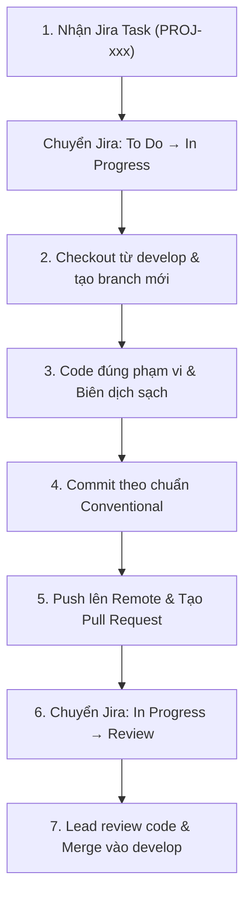

# 04. Phân Công Thành Viên & Quy Trình Git - Jira (Team Roles & Git Workflow)

> **Nhóm thực hiện**: Nhóm 11 (6 thành viên)  
> **Nguyên tắc**: "1 Jira task = 1 branch = 1 Pull Request"  
> **Mục tiêu**: Đảm bảo 100% thành viên có đóng góp code rõ ràng trên Git log để đạt điểm tối đa tiêu chí phối hợp nhóm và vấn đáp cá nhân.

---

## 1. Bảng Ma Trận Phân Công Trách Nhiệm (6 Thành Viên)

| STT | Họ và Tên | Vai Trò Chính | Trách Nhiệm Kỹ Thuật Cụ Thể | Module Quản Lý |
| :---: | :--- | :--- | :--- | :--- |
| 1 | **Nguyễn Hoàng Nam** | Trưởng nhóm & Kiến trúc sư hệ thống | Thiết kế cấu trúc `PlateNode`, cài đặt class `LicensePlateHashTable`, giải thuật băm DJB2, xử lý đụng độ Chaining, giải phóng bộ nhớ. | `Plate.h`, `HashTable.h`, `HashTable.cpp` |
| 2 | **Dư Quốc Hưng** | Kỹ sư Dữ liệu & File I/O | Xây dựng module đọc/ghi file TXT (`loadFromFile`, `saveToFile`), tạo script/hàm sinh 1.000 dữ liệu mẫu chuẩn UTF-8. | `FileIO.h`, `FileIO.cpp`, `data/sample_plates.txt` |
| 3 | **Nguyễn Ngọc Hưng** | Kỹ sư Giải thuật & Lọc Dữ liệu | Hiện thực chức năng 3 (Lọc danh sách xã của tỉnh) và chức năng 4 (Lọc biển số của xã). Xử lý thuật toán khử trùng lặp (distinct). | `AdministrativeFilter.h`, `AdministrativeFilter.cpp` |
| 4 | **Trịnh Quốc Thái** | Kỹ sư Giao diện & Ngoại lệ | Thiết kế menu console tương tác người dùng, module `Validator` kiểm tra định dạng `ab-cd-ghxyz`, xử lý chuỗi và thông báo lỗi. | `MenuUI.h`, `MenuUI.cpp`, `Validator.h`, `Validator.cpp` |
| 5 | **Huỳnh Quốc Việt** | Kỹ sư Kiểm thử (QA) & Hiệu năng | Xây dựng bộ 20 Test Cases biên, kiểm thử stress với 100 - 10.000 bản ghi, viết module `Benchmark` đo thời gian thực thi (microsecond). | `Benchmark.h`, `Benchmark.cpp`, `tests/` |
| 6 | **Huỳnh Thị Khánh Ly** | Quản lý Tài liệu & Báo cáo Dự án | Soạn thảo Báo cáo dự án 8 chương, hoàn thiện Mục 6 về Khai thác AI, chuẩn bị slide thuyết trình demo và kịch bản vấn đáp nhóm. | `docs/`, `Bao_Cao_De_Tai_11.docx`, Slides |

---

## 2. Quy Trình Git & Jira Chuẩn Của Nhóm

Tuân thủ nghiêm ngặt theo tài liệu nội bộ [MEMBER_WORKFLOW.md](file:///home/hnamhocit/Workspace/cpp/ctdl-gt-11/MEMBER_WORKFLOW.md).



### 2.1. Quy tắc đặt tên Branch:
Luôn tạo branch xuất phát từ nhánh `develop`:
```bash
git checkout develop
git pull origin develop
git checkout -b feature/PROJ-<id>-<short-name>
```

*Ví dụ:*
- `feature/PROJ-101-hashtable-core` (Nguyễn Hoàng Nam)
- `feature/PROJ-102-file-txt-io` (Dư Quốc Hưng)
- `feature/PROJ-103-filter-wards` (Nguyễn Ngọc Hưng)
- `feature/PROJ-104-console-menu-validation` (Trịnh Quốc Thái)
- `feature/PROJ-105-benchmark-test-matrix` (Huỳnh Quốc Việt)
- `feature/PROJ-106-report-docs-sync` (Huỳnh Thị Khánh Ly)

### 2.2. Quy tắc Commit Message:
Áp dụng định dạng chuẩn `feat:`, `fix:`, `docs:`, `test:`, `refactor:`:
```bash
git commit -m "feat(hashtable): implement DJB2 hash and separate chaining insert"
git commit -m "feat(validator): validate plate format ab-cd-ghxyz"
git commit -m "test(qa): add 20 edge test cases for invalid plates"
```

### 2.3. Quy trình Pull Request:
- Tiêu đề PR: `[PROJ-xxx] Tên chức năng`
- Nội dung PR bắt buộc có 2 phần:
  ```markdown
  ## Changes
  - Liệt kê các thay đổi mã nguồn đã thực hiện
  - Bổ sung hàm hoặc xử lý ngoại lệ nào

  ## Testing
  - Đã biên dịch sạch với g++ -Wall -Wextra
  - Đã chạy thử nghiệm và kiểm tra kết quả
  ```
- **Xử lý conflict**: Thành viên không tự ý giải quyết conflict phức tạp; thông báo Lead để phối hợp rebase/merge an toàn.
