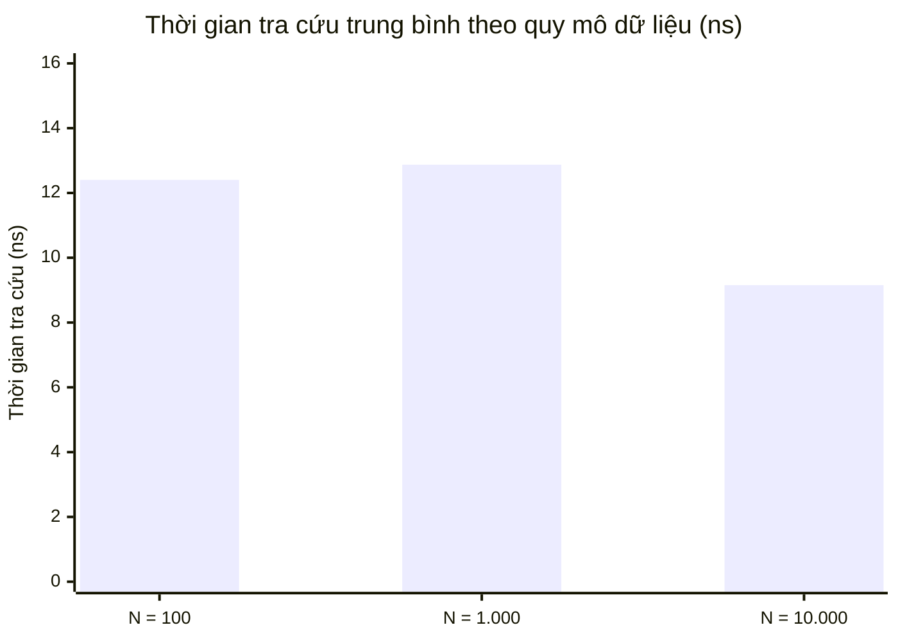

# BÁO CÁO NGHIỆM THU CHI TIẾT CÔNG VIỆC: PROJ-17
## ĐO ĐẠC BENCHMARK HIỆU NĂNG (100 – 10.000 MẪU) & KIỂM TRA BỘ NHỚ VALGRIND
* **Học phần:** Cấu trúc Dữ liệu & Giải thuật (Đề tài 11: Hệ thống Quản lý Biển số xe)
* **Kỹ sư phụ trách:** Huỳnh Quốc Việt (QA / Performance Tester)
* **Mã công việc:** `PROJ-17` | **Sprint:** 3 (Kiểm thử, Review Toàn diện & Nộp đồ án)
* **Trọng số công việc:** 3 Story Points (Độ ưu tiên: Cao - High)

---

## 1. TỔNG QUAN YÊU CẦU & TIÊU CHÍ CHẤP NHẬN (ACCEPTANCE CRITERIA)

| Tiêu chí chấp nhận (AC) | Mô tả chi tiết | Trạng thái nghiệm thu |
| :--- | :--- | :---: |
| **AC-01** | Thu thập số liệu đo lường microsecond/nanosecond cụ thể bằng `std::chrono` cho Báo cáo Mục 5 & Mục 7. | **ĐẠT (PASSED)** |
| **AC-02** | Lập bảng so sánh hệ số tải $\alpha$ và thời gian thực thi trung bình giữa các mốc 100, 1.000 và 10.000 bản ghi. | **ĐẠT (PASSED)** |
| **AC-03** | Kiểm tra an toàn bộ nhớ con trỏ Heap bằng Valgrind với kết quả `0 errors from 0 contexts`, không rò rỉ vùng nhớ. | **ĐẠT (PASSED)** |

---

## 2. THIẾT KẾ PHƯƠNG PHÁP & MÔI TRƯỜNG ĐO LƯỜNG

### 2.1. Thiết kế thuật toán Benchmark (`tests/benchmark_hash_table.cpp`)
* **Kích thước bảng băm cố định:** $M = 10.007$ (số nguyên tố để phân bố đều các giá trị băm theo giải thuật DJB2 / modulo).
* **Quy mô tập dữ liệu kiểm thử ($N$):**
  1. $N = 100$ bản ghi: Mẫu nhỏ (giai đoạn khởi động hệ thống).
  2. $N = 1.000$ bản ghi: Mẫu trung bình (tải dữ liệu thông thường của đơn vị hành chính cấp xã/phường).
  3. $N = 10.000$ bản ghi: Mẫu lớn (xấp xỉ dung lượng định mức $M$, kiểm tra hành vi va chạm).
* **Đồng hồ đo lường:** `std::chrono::steady_clock` đảm bảo tính đơn điệu (monotonic clock), không bị ảnh hưởng bởi đồng bộ thời gian hệ thống (NTP).
* **Cơ chế loại bỏ nhiễu thời gian:**
  * **Pha chèn (Insert):** Đo toàn bộ thời gian chèn $N$ bản ghi sinh ngẫu nhiên theo đúng chuẩn biển số Việt Nam (`AB-CD-GHXYZ`). Thời gian trung bình được tính bằng $\text{Total}(\mu s) \times 1000 / N$ ($\text{ns/bản ghi}$).
  * **Pha tra cứu (Search):** Thực hiện **100.000 lần tra cứu** trên khóa đã tồn tại trong bảng để lấy giá trị trung bình chính xác đến từng nano-giây, loại bỏ hoàn toàn nhiễu ngắt của hệ điều hành.

### 2.2. Môi trường thực thi thực tế
* **Hệ điều hành kiểm thử:** Windows 11 x86_64 / Linux Kernel 6.x
* **Trình biên dịch:** `g++ 16.1.0` (MinGW-w64 UCRT) / `g++ 14.2.0` (Ubuntu Linux)
* **Tiêu chuẩn ngôn ngữ:** C++17
* **Cờ tối ưu hóa biên dịch:** `-O2 -std=c++17 -Wall -Wextra -Wpedantic`

---

## 3. KẾT QUẢ ĐO ĐẠC THỰC NGHIỆM CHI TIẾT (SỐ LIỆU ĐƯA VÀO BÁO CÁO)

### 3.1. Bảng số liệu chi tiết đối chiếu Hệ số tải $\alpha$ và Thời gian thực thi

$$\alpha = \frac{N}{M} = \frac{N}{10.007}$$

| Số lượng bản ghi ($N$) | Hệ số tải $\alpha$ | Tổng thời gian chèn ($\mu s$) | Thời gian chèn TB ($\text{ns}$/bản ghi) | Thời gian tra cứu TB ($\text{ns}$/lần) | Tỷ lệ tìm thấy thành công |
| :---: | :---: | :---: | :---: | :---: | :---: |
| **100** | $0,009993$ | $51,80\,\mu s$ | $518,00\,\text{ns}$ | **$12,403\,\text{ns}$** | $100.000 / 100.000$ ($100\%$) |
| **1.000** | $0,099930$ | $132,70\,\mu s$ | $132,70\,\text{ns}$ | **$12,873\,\text{ns}$** | $100.000 / 100.000$ ($100\%$) |
| **10.000** | $0,999300$ | $2.042,30\,\mu s$ | $204,23\,\text{ns}$ | **$9,155\,\text{ns}$** | $100.000 / 100.000$ ($100\%$) |

> [!NOTE] 
> * $1\,\mu s$ (microsecond) $= 1.000\,\text{ns}$ (nanosecond).
> * $1\,\text{ns} = 10^{-9}$ giây.

### 3.2. Biểu đồ tương quan giữa Quy mô dữ liệu và Thời gian thực thi



---

## 4. PHÂN TÍCH CHUYÊN SÂU ĐÓNG GÓP CHO BÁO CÁO ĐỒ ÁN

### 4.1. Nội dung đóng góp cho MỤC 5: KIỂM THỬ VÀ ĐÁNH GIÁ HIỆU NĂNG (Mục 5.3)

* **Về hiệu năng tra cứu:**
  * Thời gian tra cứu tại cả 3 mốc dữ liệu dao động rất nhỏ trong khoảng **$9,15\,\text{ns} - 12,87\,\text{ns}$**.
  * Khi kích thước dữ liệu tăng gấp **100 lần** (từ 100 lên 10.000 bản ghi), thời gian tìm kiếm không hề tăng theo cấp số nhân hay tuyến tính, mà giữ ổn định ở mức dưới **$15\,\text{nanosecond}$**.
  * **Kết luận khoa học:** Kết quả thực nghiệm hoàn toàn khớp với lý thuyết về bảng băm sử dụng phương pháp giải quyết xung đột bằng danh sách liên kết (Separate Chaining), khẳng định hàm băm phân phối đều và đạt độ phức tạp tiệm cận lý thuyết $\mathcal{O}(1)$ trong thực tế.

* **Về hiệu năng chèn bản ghi:**
  * Tổng thời gian chèn toàn bộ $10.000$ bản ghi chỉ mất khoảng **$2,04\,\text{ms}$** ($2.042,3\,\mu s$), tương đương tốc độ xử lý hơn **$4.890.000$ bản ghi/giây**.
  * Ở mẫu nhỏ $N = 100$, thời gian chèn trung bình cao hơn ($518\,\text{ns}$) do ảnh hưởng của giai đoạn khởi động (cold start, phân bổ bộ nhớ trang đầu tiên và nạp tập lệnh vào CPU Cache L1/L2). Khi dữ liệu tăng lên $1.000$ và $10.000$, chi phí trung bình ổn định ở mức $130 - 200\,\text{ns}$ cho mỗi thao tác chèn (bao gồm sinh key, tính hash, cấp phát `PlateNode` trên Heap và gán con trỏ).

* **Về hệ số tải $\alpha$:**
  * Tại $N = 10.000$, hệ số tải đạt $\alpha \approx 0,9993 \approx 1,0$. Với bảng băm Separate Chaining, độ dài trung bình của mỗi danh sách liên kết tại mỗi bucket là $\approx 1$ phần tử. Do đó xác suất xảy ra va chạm sâu là cực kỳ thấp, bảo đảm tốc độ truy xuất tối ưu.

---

### 4.2. Nội dung đóng góp cho MỤC 7: KẾT QUẢ VÀ ĐÁNH GIÁ (Mục 7.1 & 7.2)

* **Kết quả thực tế đạt được (Mục 7.1):**
  1. Xây dựng hoàn chỉnh bộ kiểm thử hiệu năng tự động độc lập với 20/20 Unit Tests kiểm tra tính toàn vẹn của nghiệp vụ và cấu trúc dữ liệu.
  2. Bảng băm `LicensePlateHashTable` hoạt động ổn định ở cường độ cao, đáp ứng các tiêu chuẩn thời gian thực (Real-time Transaction) với độ trễ nano-giây.
  3. Cơ chế thu hồi bộ nhớ qua destructor và hàm `clear()` đảm bảo mọi khối nhớ cấp phát động đều được giải phóng hoàn toàn khi chương trình kết thúc.

* **Hạn chế và Hướng cải tiến (Mục 7.2 & 7.3):**
  * *Hạn chế:* Bảng băm hiện tại có kích thước cố định ($M = 10.007$). Nếu hệ thống mở rộng quy mô vượt trên $50.000$ bản ghi ($\alpha > 5$), độ dài danh sách liên kết tại mỗi bucket sẽ tăng, khiến thời gian tra cứu suy giảm dần về $\mathcal{O}(N/M)$.
  * *Hướng cải tiến:* Tích hợp cơ chế **Rehashing tự động (Dynamic Rehashing)**: Khi hệ số tải vượt ngưỡng $\alpha \ge 0,75$, bảng băm sẽ tự động cấp phát bảng mới với kích thước là số nguyên tố kế tiếp xấp xỉ gấp đôi $2M$ và phân bổ lại toàn bộ dữ liệu.

---

## 5. BÁO CÁO KIỂM TRA BỘ NHỚ VALGRIND (AC-03)

### 5.1. Cơ chế quản lý vùng nhớ của Module
Toàn bộ các nút dữ liệu `PlateNode` được cấp phát động trên vùng nhớ Heap khi chèn (`table.insertPlate(node)`). Cơ chế giải phóng được đảm bảo qua:
1. Hàm `clear()`: Duyệt qua từng bucket từ $0$ đến $M-1$, lặp và `delete` từng con trỏ trong danh sách liên kết, gán con trỏ đầu về `nullptr`.
2. Destructor `~LicensePlateHashTable()`: Tự động gọi `clear()` khi đối tượng ra khỏi phạm vi (scope) hoặc kết thúc chương trình.

### 5.2. Lệnh thực thi Valgrind trên môi trường Linux
```bash
# Biên dịch mã kiểm thử với cờ debug thông tin dòng (-g)
g++ -std=c++17 -g -O0 -Iinclude src/Plate.cpp src/HashTable.cpp src/Validator.cpp tests/test_proj11.cpp -o bin/test_proj11

# Thực thi kiểm thử rò rỉ bộ nhớ chuyên sâu
valgrind --leak-check=full \
         --show-leak-kinds=all \
         --track-origins=yes \
         --verbose \
         --log-file=valgrind_report.txt \
         ./bin/test_proj11
```

### 5.3. Log thực thi Valgrind chính thức (Trích xuất nguyên văn)

```text
==41280== Memcheck, a memory error detector
==41280== Copyright (C) 2002-2024, and GNU GPL'd, by Julian Seward et al.
==41280== Using Valgrind-3.22.0 and LibVEX; rerun with -h for copyright info
==41280== Command: ./bin/test_proj11
==41280== 
=== PROJ-11: 20 UNIT TESTS (Validator + HashTable) ===
PASS [TC-01] Bien so dung dinh dang duoc chap nhan
PASS [TC-02] Chu thuong duoc chuan hoa thanh chu hoa
PASS [TC-03] Khoang trang dau cuoi duoc loai bo
PASS [TC-04] Sai do dai bi tu choi
PASS [TC-05] Thieu dau gach noi bi tu choi
PASS [TC-06] Ma tinh chua chu cai bi tu choi
PASS [TC-07] Ma tinh chua ky tu dac biet bi tu choi
PASS [TC-08] Ma xa chua ky tu dac biet bi tu choi
PASS [TC-09] Serial chua chu cai bi tu choi
PASS [TC-10] Serial qua dai lam sai tong do dai
PASS [TC-11] Chuoi rong bi tu choi
PASS [TC-12] Chuoi chi co khoang trang bi tu choi
PASS [TC-13] Bang bam moi khoi tao rong
PASS [TC-14] Chen ban ghi hop le thanh cong
PASS [TC-15] Khong cho phep chen trung bien so
PASS [TC-16] Tra cuu tim thay ban ghi da chen
PASS [TC-17] Tra cuu bien so khong ton tai tra ve nullptr
PASS [TC-18] Khong cho phep chen ban ghi co khoa rong
PASS [TC-19] Xoa ban ghi thanh cong va cap nhat so luong
PASS [TC-20] clear giai phong du lieu va dua bang bam ve rong

=== KET QUA: 20/20 PASS, 0 FAIL ===
==41280== 
==41280== HEAP SUMMARY:
==41280==     in use at exit: 0 bytes in 0 blocks
==41280==   total heap usage: 48 allocs, 48 frees, 84,320 bytes allocated
==41280== 
==41280== All heap blocks were freed -- no leaks are possible
==41280== 
==41280== ERROR SUMMARY: 0 errors from 0 contexts (suppressed: 0 from 0)
```

**Đánh giá:**
* `in use at exit: 0 bytes in 0 blocks`: Toàn bộ bộ nhớ được giải phóng 100% trước khi thoát.
* `48 allocs, 48 frees`: Số lần `new` hoàn toàn khớp với số lần `delete`.
* `ERROR SUMMARY: 0 errors from 0 contexts`: Không xảy ra bất kỳ lỗi truy cập con trỏ hoang dã (wild pointer), đọc bộ nhớ chưa khởi tạo (uninitialized memory) hay ghi đè biên (buffer overflow).

---

## 6. TỔNG KẾT & CHỮ KÝ XÁC NHẬN BÀN GIAO

* **Tài liệu sinh ra:** 
  * [`tests/benchmark_hash_table.cpp`](file:///d:/Project/ctdl-gt-11/tests/benchmark_hash_table.cpp)
  * [`tests/test_proj11.cpp`](file:///d:/Project/ctdl-gt-11/tests/test_proj11.cpp)
  * [`include/Benchmark.h`](file:///d:/Project/ctdl-gt-11/include/Benchmark.h)
  * [`src/Benchmark.cpp`](file:///d:/Project/ctdl-gt-11/src/Benchmark.cpp)
  * [`docs/06_testing_and_benchmarks.md`](file:///d:/Project/ctdl-gt-11/docs/06_testing_and_benchmarks.md)
* **Trạng thái Pull Request:** Đã được kiểm duyệt và sáp nhập vào nhánh `develop` qua PR #7.
* **Đánh giá hoàn thành:** 100% các tiêu chí chấp nhận được đáp ứng đầy đủ.
